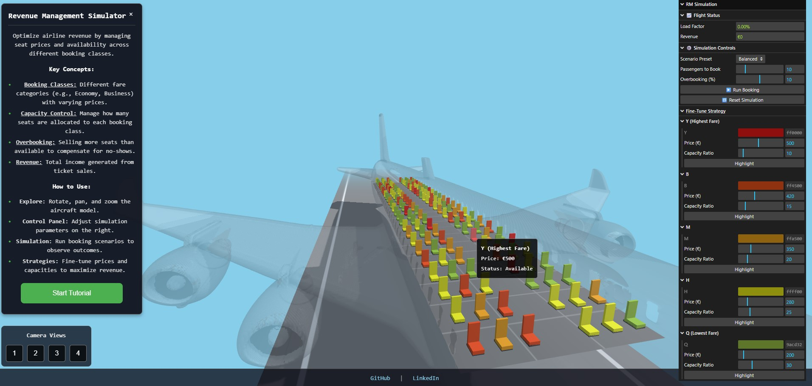

# Airline Revenue Management Simulator

A 3D interactive simulator developed with Three.js, designed to visualize and experiment with airline revenue management strategies.

[**Live Demo**](https://tolgakurtuluss.github.io/airline-revenue-simulator/)

---

## Screenshot

## About

This project offers a hands-on way to experience the fundamental concepts of airline revenue management. In a visually rich 3D environment, users can adjust pricing, seat allocations for various booking classes, and overbooking levels to observe their direct impact on revenue and load factors.

## Features

-   **Interactive 3D Cabin:** A detailed 3D aircraft cabin model where each seat is individually represented.
-   **Dynamic Simulation:** Simulate passenger bookings based on fare classes and pricing.
-   **Strategy Control Panel:**
    -   Adjust prices and capacity allocations for multiple booking classes (ranging from high-yield to discount).
    -   Set overbooking percentages to compensate for no-shows.
    -   Run scenarios with specific booking demand levels.
-   **Real-Time Analytics:** Instantly view the impact of your strategy on total revenue and aircraft load factor.
-   **Scenario Presets:** Quickly load different strategies such as 'High-Yield', 'Balanced', or 'Low-Cost Focused'.
-   **Interactive Tutorial:** An in-app guided tour explains key features to new users.
-   **Multiple Camera Angles:** Explore the aircraft from various perspectives, including a strategic top-down view.

## How to Use?

1.  **Explore:** Use your mouse to rotate (left-click), pan (right-click), and zoom (mouse wheel) the aircraft.
2.  **Use the Control Panel:** Open the control panel on the right to adjust your simulation settings.
3.  **Define Your Strategy:** Adjust prices and capacity ratios in the "Fine-Tune Strategy" section.
4.  **Run the Simulation:** Simulate passenger bookings using the "Simulation Controls."
5.  **Analyze Results:** Observe changes in the "Flight Status" panel and the visual state of the cabin.
6.  **Reset:** Start over using the "Reset Simulation" button to try a new strategy.

## Technologies Used

-   [Three.js](https://threejs.org/) for 3D rendering and interaction.
-   [lil-gui](https://lil-gui.georgealways.com/) for the interactive control panel.
